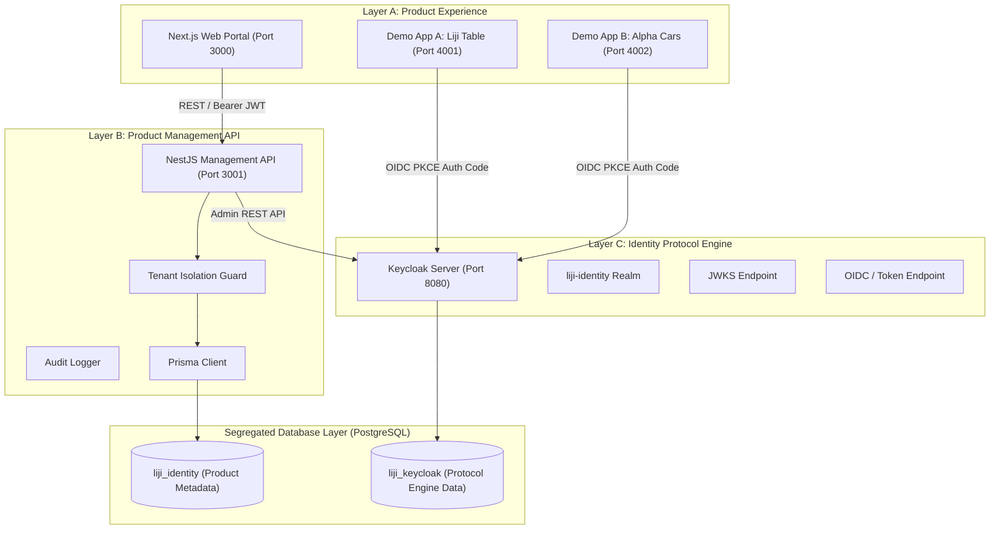

# L's - Auth: System Architecture
**Parent Organization:** Liji Groups  
**Product Positioning:** "One Identity. Every Application."

---

## 1. High-Level Architectural Overview

L's - Auth is structured into three discrete, decoupled layers to maintain strict separation of concerns, enterprise security posture, and long-term modularity:

---

## 2. Layer Responsibilities

### Layer A — Product Experience (Next.js App Router)
- **Administration Portal:** Organization management, user memberships, application registries, audit logging, and subscription views.
- **Brand Identity:** Dark navy and slate background palette (`#0F172A`, `#1E293B`) with restrained blue accent (`#2563EB`) and typographic wordmark for L's - Auth.
- **Consumer Applications:** Demonstrated through two production-pattern applications:
  - **Demo App A (Liji Table):** Port 4001
  - **Demo App B (Alpha Cars):** Port 4002

### Layer B — Product Management API (NestJS)
- **Tenant Scope Enforcement:** Every endpoint under `/api/v1/organizations/:organizationId/*` strictly requires authenticated active membership in the target organization.
- **Protocol Provisioning:** Keycloak client and realm provisioning executed through controlled administrative APIs.
- **Audit Trails:** Immutable recording of tenant actions, security policy modifications, and membership invitations.
- **Database Segregation:** Prisma connects solely to `liji_identity`. Keycloak internal tables are never directly accessed or queried.

### Layer C — Identity Protocol Engine (Keycloak)
- Centralized token issuance, signing, PKCE validation, session cookie lifecycle, and JWKS exposure.
- Connected exclusively to `liji_keycloak` PostgreSQL database.

