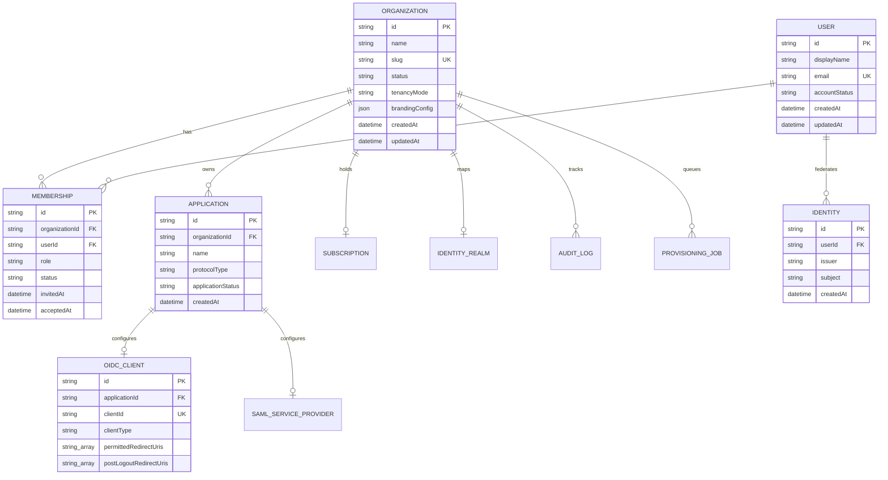

# L's - Auth: Database Schema & Storage Architecture

## 1. Segregation Model

To ensure security boundaries and protocol integrity:
- **`liji_identity`**: Managed solely via Prisma ORM for organizations, memberships, apps, audit records, and subscriptions.
- **`liji_keycloak`**: Managed solely by Keycloak's internal migration and persistence layer. The management API never reads or writes to this database directly.

---

## 2. Relational Entity Relationship Diagram

---

## 3. Data Protection Rules
- **No Plaintext Passwords or Secrets:** Product database holds client ID references and metadata. Client secrets, private keys, and user password hashes remain exclusively inside Keycloak.
- **Unique Constraints:** `(issuer, subject)` in `identities`, `(organizationId, userId)` in `memberships`, and `slug` in `organizations`.

