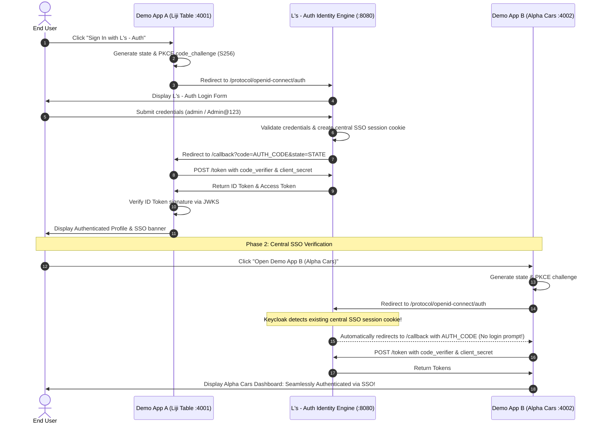

# L's - Auth: OpenID Connect & SSO Integration Guide

## 1. SSO Verification Workflow

This document explains the Single Sign-On (SSO) test scenario between **Demo App A (Liji Table)** and **Demo App B (Alpha Cars)**:

---

## 2. Security Notes
- Existing central identity sessions authenticate identity, but application-specific authorization rules and organization scopes are still evaluated independently by each application.
- Public clients must use PKCE with confidential client secrets omitted.
- Tokens must always be verified against Keycloak's JWKS endpoint.
